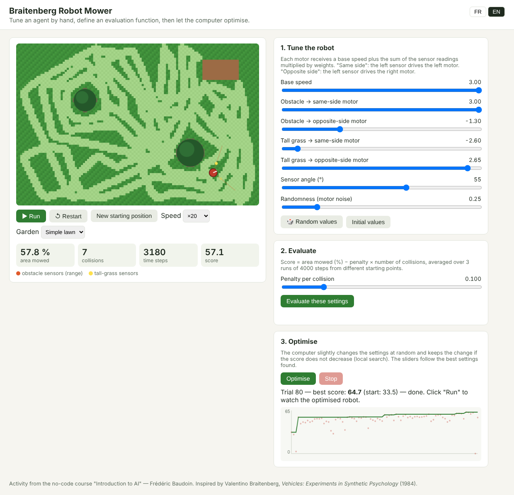

# Braitenberg Robot Mower

**An interactive, no-code introduction to agents, evaluation functions and optimisation.**

▶ **Live demo:** https://baudoin2020-cyber.github.io/mower/ (French by default, add `?lang=en` for English)

## What it is

A robot lawn mower drives around a garden. It has no map and no plan: like the vehicles imagined by
Valentino Braitenberg (*Vehicles: Experiments in Synthetic Psychology*, 1984), it only connects
**sensors** to **motors** through a handful of weights.

- Two **obstacle sensors** (orange) measure how close a tree, a wall or a shed is, on the left and on the right.
- Two **tall-grass sensors** (yellow) detect whether the grass just ahead is still uncut.
- Each wheel speed is `base speed + Σ weight × sensor reading (+ noise)`. A "same-side" weight links the
  left sensor to the left motor; an "opposite-side" weight links it to the right motor.
- As on real robot mowers, a bumper reflex makes the robot back off and turn at random when it hits something.

Seven sliders control the robot's behaviour. Three gardens are available: a simple lawn, an orchard and corridors.

## How it is used in class

This is the second session of a 15-hour no-code **Introduction to AI** course for first-year computer-science
students. The activity has three steps, mirroring the page layout:

1. **Tune by hand.** Students try to make the robot mow as much as possible. They quickly discover emergent
   behaviour: a positive same-side obstacle weight makes the robot avoid trees, a positive opposite-side
   grass weight makes it steer towards uncut grass.
2. **Evaluate.** "Mowing well" has to be turned into a number. The score is the percentage of lawn mowed
   minus a penalty per collision, averaged over three runs with different starting points. Students debate
   the penalty: with a penalty of zero, collisions simply no longer matter to the robot.
3. **Optimise.** The computer runs a simple local search ((1+1) evolution strategy): it mutates the current
   settings at random and keeps the mutation if the score does not decrease. The chart shows every trial (dots)
   and the best score so far (line). In a typical run the score goes from about 33 to about 65 in fewer than
   100 trials, and the optimised weights can be interpreted.

Discussion points that lead into the next sessions:

- **The machine optimises exactly what we measure**, not what we meant (reward specification).
- **Overfitting:** optimise on the orchard, then test on the corridors.
- **Randomness in evaluation:** why average over several runs?

## Run it

Open `index.html` in any modern browser. It is a single self-contained file with no dependencies.

To publish it with GitHub Pages: *Settings → Pages → Deploy from a branch → `main` / root*.

## Author

Frédéric Baudoin, PhD in Artificial Intelligence (LIP6, Université Paris VI). Mathematics and algorithms lecturer.
